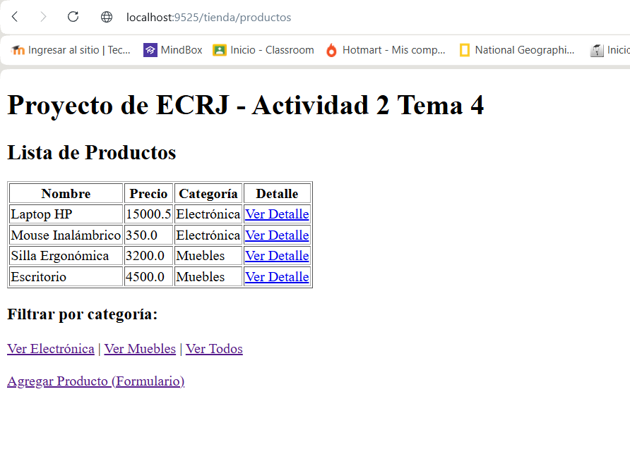
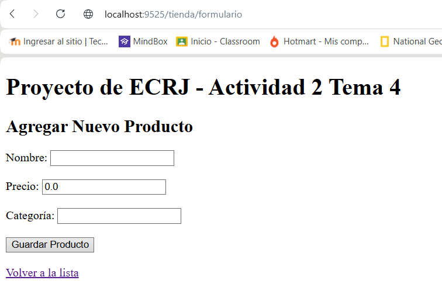
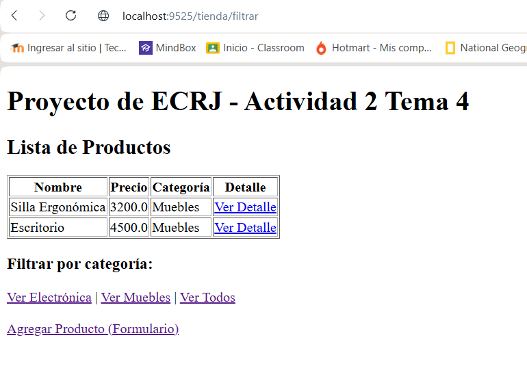
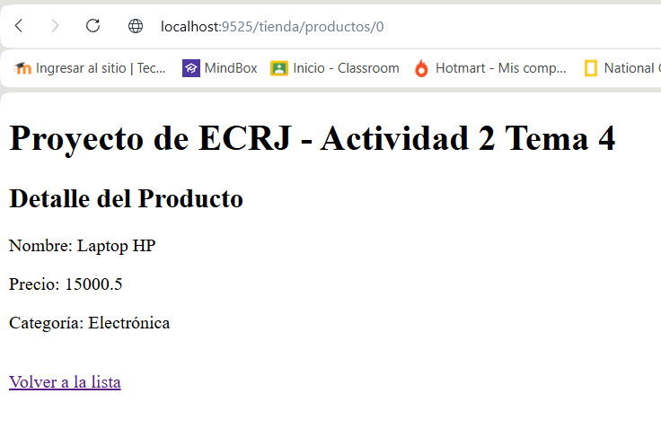
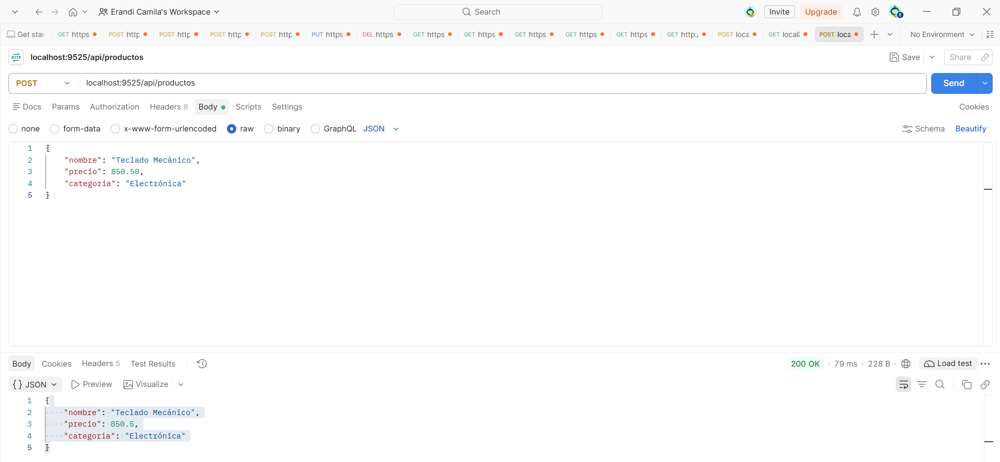

# Act2. Spring MVC - Vistas con Thymeleaf, DTOs y Manejo de Peticiones

Ruíz Jiménez Erandi Camila

## Objetivo de la Práctica
Comprender el patrón MVC en Spring Boot usando Thymeleaf para renderizar vistas del lado del servidor, estructurar datos con clases DTO, manejar parámetros de distintas formas (`@RequestParam`, `@PathVariable`, `@ModelAttribute`), configurar valores externos con `@Value`, y probar peticiones POST con Postman. Todo esto construido sobre una copia del proyecto de la Actividad 1, sin modificar el original y desplegándolo en un puerto diferente en el VPS.

## Material de Estudio (Playlist del Curso)
Para el desarrollo de esta práctica, se revisaron los videos del **8 al 17** del curso "Curso completo de Java Spring Boot desde cero":
 *   [https://youtube.com/playlist?list=PL2Z95CSZ1N4EWw14HZ0NFD3woFcn6uiCm](https://youtube.com/playlist?list=PL2Z95CSZ1N4EWw14HZ0NFD3woFcn6uiCm)

*(Nota: Se conservó el código de los ejemplos de los videos en el proyecto, y se agregó un nuevo módulo independiente de "Tienda" para cumplir con los requisitos de esta entrega).*

---

## Tecnologías y Conceptos Aplicados

*   **Patrón MVC:** Separación de responsabilidades (Modelo, Vista, Controlador) y uso del `DispatcherServlet`.
*   **Thymeleaf:** Motor de plantillas para renderizar HTML en el servidor (uso de `th:each`, `th:text`, etc.).
*   **DTO (Data Transfer Object):** Creación de `ProductoDTO` para transportar datos de forma segura.
*   **Manejo de parámetros:** Recepción de datos mediante `@RequestParam`, `@PathVariable` y `@ModelAttribute`.
*   **@Value:** Lectura de propiedades externas desde `application.properties`.
*   **API REST:** Creación de un endpoint POST para consumir JSON.

---

## Evidencias del Proyecto

### 1. Vista de Lista (Thymeleaf y @Value)
Vista que muestra la lista de productos simulada, recorriéndola con la directiva `th:each`. Además, se muestra el título de la app leyendo la propiedad con `@Value`.

### 2. Formulario con @ModelAttribute
Formulario web que captura los datos del producto y los envía a través del método POST para ser procesados por el controlador.

### 3. Endpoint con @RequestParam (Filtro)
Resultado de filtrar la lista de productos por su categoría a través de la URL (ej. `?categoria=Muebles`).

### 4. Endpoint con @PathVariable (Detalle)
Vista que muestra el detalle de un producto específico obtenido a través de su ID en la ruta (ej. `/productos/0`).

### 5. Petición POST en Postman (REST)

---

## Despliegue en el VPS (AWS EC2)

1.  **Ejecución:** Se abrió el puerto **8084** en el Security Group de AWS y se ejecutó el proyecto en segundo plano utilizando el puerto 8084.

---

## Enlaces

Proyecto en VPS (Actividad 2 - Puerto 8084): http://18.218.44.223:8084/tienda/productos

Proyecto en VPS (Actividad 1 - Puerto 8081): http://18.218.44.223:8081/detalle_info2